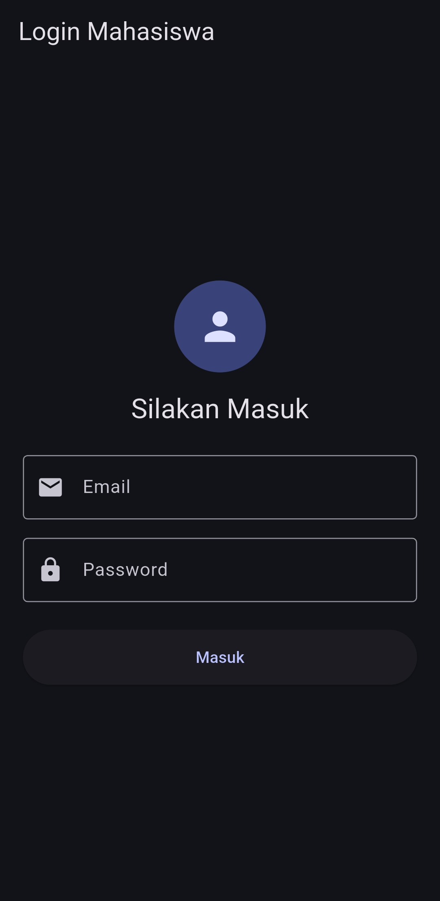
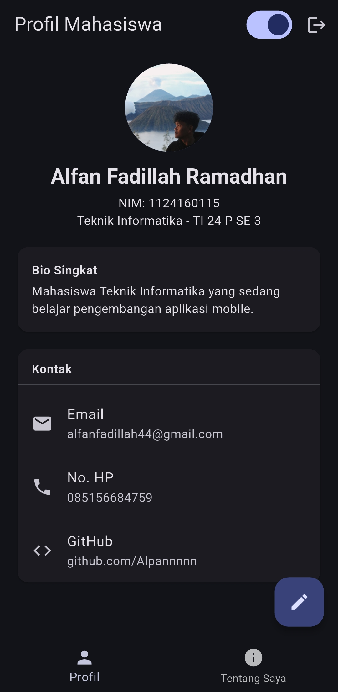
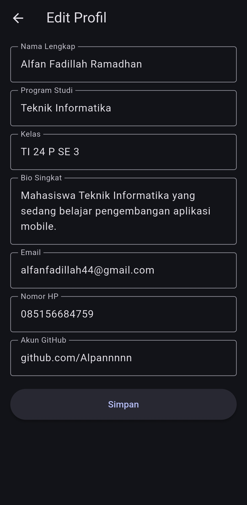

# UTS Pemrograman Mobile Lanjut — Aplikasi Profil Mahasiswa

Repository ini berisi hasil pengerjaan Ujian Tengah Semester (UTS) mata kuliah **Aplikasi Mobile** berbasis Flutter.

## Identitas Mahasiswa
- **Nama:** Alfan Fadillah Ramadhan
- **NIM:** 1124160115
- **Kelas:** TI 24 P SE 3
- **Program Studi:** Teknik Informatika
- **Institusi:** Institut Teknologi & Bisnis Bina Sarana Global

## Video Presentasi & Demo
- **Link YouTube:** [Tonton Video Presentasi UTS PML](https://youtu.be/FUwZaT1UTWk)


## Fitur Utama Aplikasi (`soal2-profil-app`)
1. **Halaman Login (`LoginPage`):**
   - Validasi input menggunakan `Form` dan `GlobalKey<FormState>` (kolom wajib diisi, format email mengandung `@`, dan password minimal 6 karakter).
   - Indikator *loading* saat proses autentikasi berlangsung.
   - Navigasi ke halaman profil menggunakan `Navigator.pushReplacementNamed` disertai notifikasi `SnackBar`.
2. **Halaman Profil (`ProfilePage`):**
   - Menampilkan foto profil (`CircleAvatar`), nama lengkap, NIM, program studi, dan kelas.
   - Kartu informasi **Bio Singkat** dan **Kontak** (Email, Nomor HP, Akun GitHub) menggunakan widget kustom `InfoTile`.
   - Tombol `Switch` pada `AppBar` untuk mengganti tema terang dan gelap secara dinamis, serta tombol logout.
   - `FloatingActionButton` untuk membuka halaman edit profil dan `BottomNavigationBar` untuk berpindah ke halaman **Tentang Saya**.
3. **Halaman Edit Profil (`EditProfilePage`):**
   - Form praisi (*pre-filled*) menggunakan `TextEditingController` yang diinisialisasi pada `initState()`.
   - Validasi input nama, email, dan nomor HP (10–13 digit angka).
   - Pengiriman data pembaruan kembali ke `ProfilePage` menggunakan `Navigator.pop(context, dataBaru)` yang memicu `setState()` dan notifikasi `SnackBar`.
4. **Halaman Tentang Saya (`AboutPage`):**
   - Menampilkan daftar **Riwayat Pendidikan** dan **Keahlian & Hobi** menggunakan `ListView` dan `Card` dengan navigasi `BottomNavigationBar` yang konsisten.

## Screenshot Aplikasi

| Halaman Login | Halaman Profil | Halaman Edit Profil |
| :---: | :---: | :---: |
|  |  |  |

## Cara Menjalankan Aplikasi
1. Clone repository ini:
   ```bash
   git clone [https://github.com/Alpannnnn/uts-pml-1124160115.git](https://github.com/Alpannnnn/uts-pml-1124160115.git)
   cd uts-pml-1124160115/soal2-profil-app
   ```
2. Unduh seluruh dependensi Flutter:
   ```bash
   flutter pub get
   ```
3. Jalankan aplikasi pada perangkat Android atau emulator:
   ```bash
   flutter run
   ```
4. Untuk membangun file APK rilis:
   ```bash
   flutter build apk --release
   ```