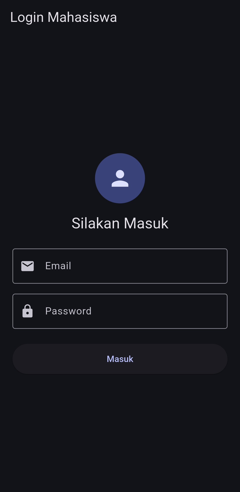
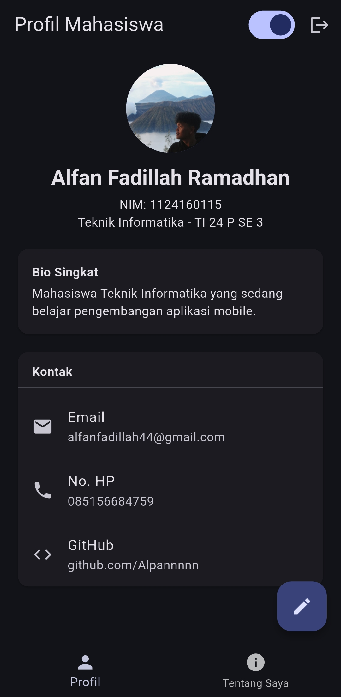
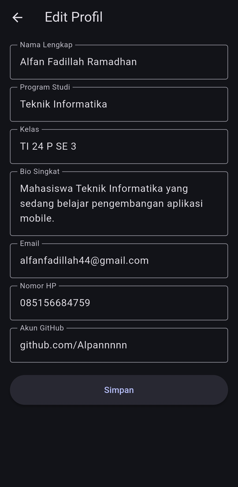

# Soal 2 — Aplikasi Profil Mahasiswa (`Profil Alfan`)

Aplikasi mobile multi-halaman berbasis Flutter untuk menampilkan dan mengelola data profil mahasiswa.

## Identitas Pengembang
- **Nama:** Alfan Fadillah Ramadhan
- **NIM:** 1124160115
- **Kelas:** TI 24 P SE 3

## Arsitektur & Komponen Flutter yang Digunakan
- **`MaterialApp` (`lib/main.dart`):** Mengatur `theme`, `darkTheme`, `themeMode` berbasis state `isDark`, `initialRoute: '/'`, serta pemetaan `routes` (`'/'`, `'/profile'`, `'/about'`).
- **`Scaffold`:** Kerangka utama setiap layar yang memuat `AppBar`, `body`, `FloatingActionButton`, dan `BottomNavigationBar`.
- **`Form` & `validator`:** Validasi input form pada `LoginPage` dan `EditProfilePage` menggunakan `GlobalKey<FormState>`.
- **`setState()`:** Pembaruan antarmuka reaktif saat mengubah tema terang/gelap maupun menyimpan perubahan data `Profile`.
- **`Navigator`:** Pengiriman data dua arah antara `ProfilePage` dan `EditProfilePage` melalui `await Navigator.push(...)` dan `Navigator.pop(context, dataBaru)`.

## Screenshot Aplikasi

| Login | Profil | Edit Profil |
| :---: | :---: | :---: |
|  |  |  |

## Cara Menjalankan
```bash
flutter pub get
flutter run
```